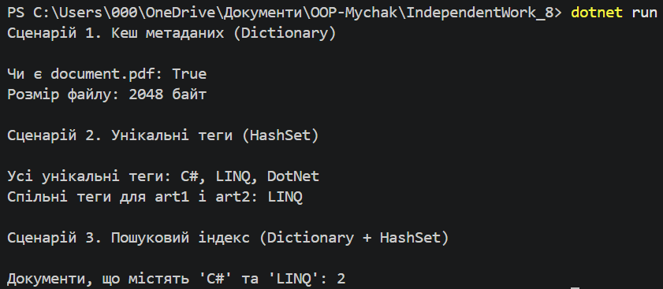

# Звіт з Самостійної роботи №14 (IndependentWork_8)

Тема: Вивчення Dictionary<TKey, TValue> та HashSet<T> у бібліотеках .NET.  
Мета: Дослідити приклади використання узагальнених колекцій у відкритих .NET-проєктах, реалізувати практичні сценарії кешування, роботи з тегами та пошукового індексу.

Примітка: Назву папки було обрано як IndependentWork_8 для збереження послідовності та уникнення конфліктів назв у репозиторії.

## Частина 1. Аналіз використання у відкритих проєктах

1. **Newtonsoft.Json — Dictionary<TKey, TValue>**
   - **Контекст:** Використовується для кешування рефлексійних метаданих об'єктів та контрактів серіалізації (`JsonContractCache`).
   - **Чому обрано:** Забезпечує доступ до згенерованих типів за типом `Type` або рядковим ім'ям за O(1).
   - **Складність:** O(1) для пошуку та додавання.
   - **Вимоги:** Використовує кастомні порівнювачі для швидкого пошуку ключів без зайвого boxing.

2. **Entity Framework Core — HashSet<T>**
   - **Контекст:** Використовується у трекері змін (`ChangeTracker`) для відстеження множини змінених сутностей та їх завантажених навігаційних властивостей.
   - **Чому обрано:** Забезпечує миттєву перевірку унікальності об'єкта та гарантує відсутність дублікатів сутностей у наборі.
   - **Складність:** O(1) для операцій додавання та перевірки `Contains`.

3. **AutoMapper — Dictionary + HashSet разом**
   - **Контекст:** У конфігурації маппінгу використовується Dictionary для зберігання карт типів (SourceType -> DestinationType), а значення містять HashSet із невикористаними або ігнорованими властивостями.

---

## Частина 2. Порівняльна таблиця

| Операція | List<T> | Dictionary<TKey, TValue> | HashSet<T> | Коли використовувати |
| :--- | :---: | :---: | :---: | :--- |
| **Додавання** | O(1) | O(1) | O(1) | List — для збереження порядку; Dict/HashSet — для швидкого доступу |
| **Пошук за значенням** | O(n) | N/A | O(1) | HashSet — коли потрібен миттєвий пошук значень без дублікатів |
| **Пошук за ключем** | N/A | O(1) | N/A | Dictionary — коли є зв'язок "ключ-значення" |
| **Видалення** | O(n) | O(1) | O(1) | Dict/HashSet видаляють за O(1) без зсуву масиву |
| **Перевірка наявності** | O(n) | O(1) | O(1) | HashSet — для операцій над множинами (перетин, об'єднання) |

---

## Частина 3. Висновки

1. **Коли Dictionary краще за List:** Коли треба швидко шукати об'єкти за унікальним ідентифікатором (ключем), а не шукати перебором O(n).
2. **Коли HashSet є оптимальним:** Коли потрібна унікальність елементів і висока швидкість перевірки наявності або виконання математичних операцій над множинами (Union, Intersect).
3. **Підводні камені:** Якщо об'єкти мутують (змінюються поля, що беруть участь у `GetHashCode`), то пошук у HashSet чи Dictionary може "зламатися". Також слід пам'ятати про вибір коректного `IEqualityComparer` (наприклад, `StringComparer.OrdinalIgnoreCase` для рядків).

---

## Контрольні запитання

1. **Переваги generic-колекцій:** Забезпечують типобезпеку під час компіляції та уникають витрат ресурсів на упакування/розпакування (boxing/unboxing).
2. **Dictionary vs HashSet:** Dictionary використовується, коли є асоціація між ключем та значенням. HashSet — коли потрібна тільки унікальна множина значень.
3. **Роль IEqualityComparer<T>:** Визначає правила обчислення хеш-коду та рівності елементів. Коректний компаратор запобігає колізіям та пришвидшує роботу колекцій.
4. **Чому інвертований індекс будують на Dictionary + HashSet:** Dictionary дозволяє за O(1) знайти слово, а HashSet за O(1) зберігає унікальні ID документів та дозволяє виконувати швидкі операції `IntersectWith` для багатослівних запитів.

