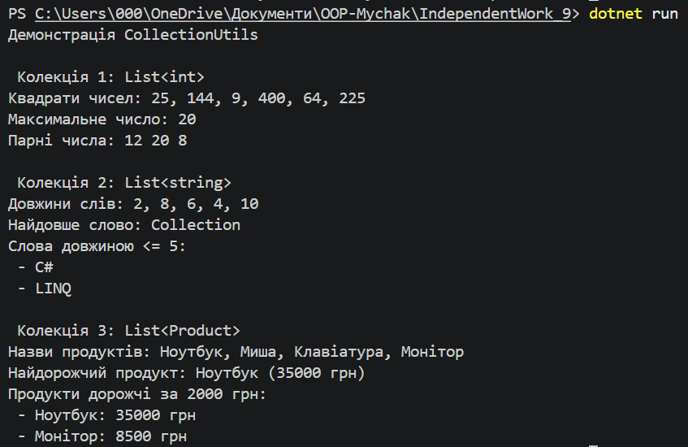

#  Самостійна робота №15 

Тема: Делегати й лямбда-вирази: власні утиліти для колекцій.
Мета: Поглибити розуміння делегатів та лямбда-виразів через створення власних узагальнених методів-утиліт для роботи з колекціями.

Примітка: Назву папки змінила на  IndependentWork_9 для забезпечення унікальності та дотримання схеми найменувань у репозиторії.

Хід роботи:
1. Створила консольний проєкт IndependentWork_9.
2. Реалізувала статичний клас `CollectionUtils` з узагальненими методами `Map`, `MaxBy`, `Filter` та `ForEach`.
3. У методі `Main` продемонструвала роботу кожного методу на трьох різних типах колекцій: `List<int>`, `List<string>` та `List<Product>`.
4. Підготувала відповіді на теоретичні питання та порівняльний аналіз з LINQ.

Контрольні запитання та висновки:
1. **Чому делегати корисні для утиліт:** Вони дозволяють передавати логіку обробки як параметр у метод, роблячи функції максимально гнучкими.
2. **Як лямбда-вирази спрощують виклик:** Вони дають змогу записувати анонімні функції лаконічно (наприклад, `p => p.Price`) прямо в місці виклику без створення окремих методів.
3. **Порівняння з LINQ-операторами:**
   - `Map<TSource, TResult>` відповідає `Select()`
   - `Filter<T>` відповідає `Where()`
   - `MaxBy<T, TKey>` відповідає `MaxBy()` (.NET 6+)
   - `ForEach<T>` відповідає виклику `foreach` або `List.ForEach()`
4. **Різниця делегатів:** `Func<T, TResult>` повертає значення, `Predicate<T>` повертає `bool` для умов, а `Action<T>` виконує дію без повернення значення (`void`).

