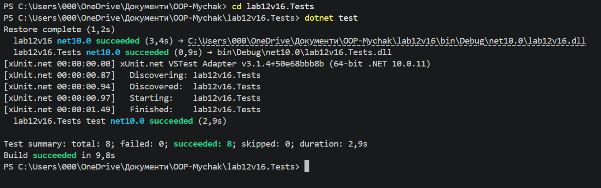

# Звіт лабораторна робота 7 

**Тема:** Узагальнені типи (Generics). IRepository з where-обмеженнями та тестами.

**Мета:** Навчитися створювати узагальнені інтерфейси та класи з where-обмеженнями і розробляти юніт-тести для їх перевірки.

## Хід роботи
1. Створено консольний проєкт `lab12v16` та тестовий проєкт `lab12v16.Tests` (xUnit) із посиланням на основний.
2. Реалізовано інтерфейс `IEntity` та сутність `BlogPost` (Варіант 16: Title, Content, AuthorId).
3. Створено узагальнений інтерфейс `IRepository<T>` з обмеженням `where T : class, IEntity` та його реалізацію `InMemoryRepository<T>` на базі `List<T>`.
4. Написано 8 юніт-тестів для перевірки всіх CRUD-операцій та обробки винятків `KeyNotFoundException`.

## Контрольні запитання
1. **Роль where-обмежень:** Гарантують наявність потрібних властивостей (наприклад, `Id`) або типів у параметра `T`.
2. **Переваги IRepository:** Відокремлює логіку збереження даних від бізнес-логіки, що спрощує тестування.
3. **Важливість тестів для Generics:** Дозволяють перевірити коректність універсального коду без запуску всього застосунку.
4. **Переваги Generics над object:** Забезпечують типобезпеку та відсутність витрат на boxing/unboxing.

