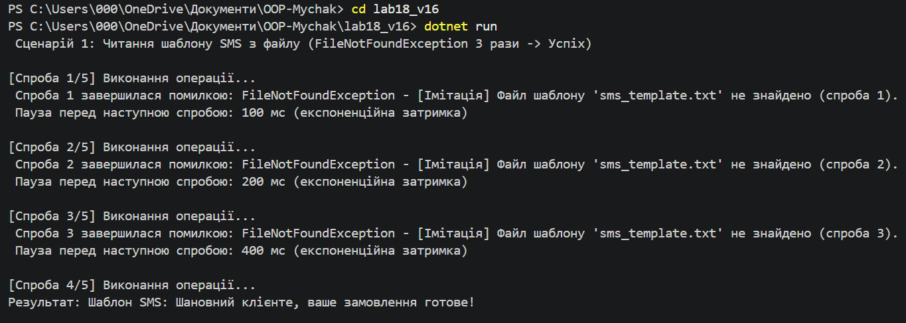
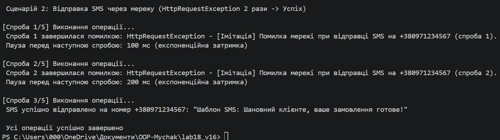

#  Лабораторноа робота №12 

Тема: Обробка IO/мережевих помилок та патерн Retry.
Мета: Навчитися обробляти помилки вводу/виводу та мережі за допомогою try-catch-finally, а також реалізувати патерн Retry з експоненційною затримкою.

Примітка: Назву папки було обрано як lab18_v16 для забезпечення унікальності та збігу з правилами іменування у репозиторії.

Хід роботи:
1. Створено консольний проєкт lab18_v16.
2. Реалізовано класи FileProcessor та NetworkClient(Відправка SMS):
   - `GetSmsTemplate` імітує `FileNotFoundException` перші 3 рази, після чого повертає текст.
   - `SendSms` імітує `HttpRequestException` перші 2 рази, після чого успішно відправляє повідомлення.
3. Розроблено узагальнений клас `RetryHelper` з методом `ExecuteWithRetry`, логуванням спроб, експоненційною затримкою та делегатом `shouldRetry`.
4. У методі `Main` продемонстровано успішний перехід обох операцій від тимчасових помилок до успіху.

Контрольні запитання:
1. Типи винятків: Для файлів — `FileNotFoundException`, `DirectoryNotFoundException`, `IOException`. Для мережі — `HttpRequestException`, `SocketException`.
2. Принцип Retry: Патерн повторює виконання операції визначену кількість разів після виникнення тимчасової помилки. Його доцільно використовувати для нестабільних мережевих запитів або доступів до файлів.
3. Експоненційна затримка: Збільшує час очікування між спробами за формулою `initialDelay * 2^(attempt - 1)` (наприклад: 100мс, 200мс, 400мс, 800мс). Це зменшує навантаження на систему при збоях.
4. Призначення shouldRetry: Делегат дозволяє фільтрувати винятки й повторювати спроби лише для тимчасових помилок, відразу пропускаючи фатальні помилки (наприклад, критичні помилки доступу чи конфігурації).

